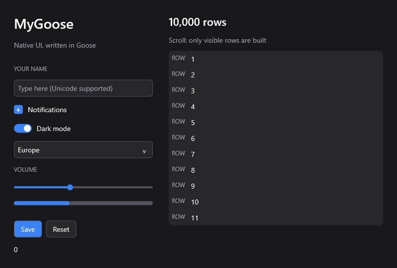
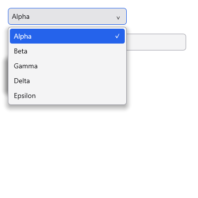

# MyGoose

**Experimental.** APIs and the native ABI may change without compatibility
guarantees while the toolkit develops.

Native desktop UI written in Goose. State and views are Goose; layout, controls, focus,
UTF-8 editing, virtualization and damage tracking are Goose too. A small C
backend provides the window, fonts, clipboard and drawing. Windows, Linux
(including WSL2), and Apple Silicon macOS are tested. See
[platform architecture and validation](docs/platforms.md).

MyGoose began as a Goose reimplementation of the architecture and examples of
[MyZig](https://github.com/abishek77s/myzig), which began as a port of
[MyGo](https://github.com/egoist/mygo)'s native UI. MyGoose has since developed
its own implementation and platform backends. Upstream MIT notices are
preserved in [LICENSE](LICENSE).



On Windows, Direct2D + DirectWrite renders every control: smooth rounded shapes, fractional glyph
positions, system font fallback and grayscale text antialiasing. The DC render
target uses software rendering, so it needs no GPU driver and the headless
renderer produces the same pixels as a window. Direct2D and DirectWrite are
required Windows dependencies. MyGoose uses no webview or bundled fonts.
Linux uses X11 with Cairo/Pango; macOS uses AppKit with CoreGraphics/CoreText.
The Goose core and examples are shared across all three backends.

Representative Counter executable sizes (decimal KB):

| Platform | Architecture | Default `goose build` | MyGoose `small` build |
| --- | --- | --- | --- |
| macOS | aarch64 (Apple Silicon) | Not measured | ~120 KB |
| Windows | x86-64 | ~428 KB | ~103 KB |
| Linux (Ubuntu under WSL2) | x86-64 | Not measured | ~72 KB |

The Windows measurements use the [pinned Goose revision](tools/toolchain.json)
and MinGW-w64 GCC 15.2.0. The default is 427,605 bytes, built with
`goose build examples/counter.goose --cc gcc -o build/counter-default.exe`.
All three `small` measurements, including macOS aarch64, use
`python3 tools/build.py counter --mode small` (use `python` on Windows).

The [`small` build](tools/build.py) emits C with Goose `-O2 --standalone`,
then compiles the application and native backend with `-Os`, `-flto` and
`-ffunction-sections`. Linking removes unused code with `--gc-sections` on
Windows/Linux or `-dead_strip` on macOS; Windows/Linux also use `-s` to strip
symbols. Plain `goose build` uses native `-O2` (or MSVC `/O2`) without these
extra size options.

These are approximate executable file sizes, excluding macOS app-bundle icons
and metadata. System libraries are supplied by the OS. Size varies with the
app, platform, compiler and build mode.

## Build and run

Requires Python 3.10+, Git, CMake 3.27+ and a C++20 compiler to bootstrap the
pinned Goose compiler. Application builds use Apple Clang on macOS, MinGW-w64
GCC on Windows, or GCC with X11/Cairo/Pango development packages on Linux.
Python tooling has no third-party package dependencies.

```sh
git clone https://github.com/akeit0/mygoose.git
cd mygoose
python3 tools/bootstrap.py
python3 tools/build.py gallery --run
```

On Windows use `python` instead of `python3`. The compiler revision is recorded
in [`tools/toolchain.json`](tools/toolchain.json); it builds inside the ignored
`.toolchain` directory. `GOOSE`/`--goose` and `MYGOOSE_CC`/`--cc` select existing
compilers. See [platform setup](docs/platforms.md) for native dependencies,
CMake/package builds and WSL2 instructions.
[Goose compatibility notes](docs/goose-issues.md) track compiler/package
workarounds and reproduction details for upstream follow-up.

Other apps include the [activity monitor](apps/monitor/README.md), the
[performance lab](apps/performance/README.md), a text editor, tables, charts,
images and motion examples. Pass their target name to the builder:

```sh
python3 tools/build.py monitor --run
python3 tools/build.py performance --run
python3 tools/build.py editor --run
```

Activity Monitor's visual design closely follows [Pulse](https://pulse.egoist.dev/)
by EGOIST. It is implemented with Goose, MyGoose and native C without using
Pulse source code. See the [Monitor design credit](apps/monitor/README.md).

On macOS, `python3 tools/macos.py --all --install` creates ad-hoc signed local app
bundles in `~/Applications/MyGoose`. Without `--all`, it installs Gallery and
Activity Monitor. Monitor uses an integrated title bar with native traffic
lights; `--window-style standard` keeps a separate system title bar.

Build modes are `small` (default, `-Os`/LTO), `fast` (`-O3`/LTO) and `debug`
(runtime checks and symbols). Outputs go to `build/macos-MODE`,
`build/linux-MODE`, or `build/MODE` on Windows. Windows apps default to the GUI
subsystem; `--console` enables diagnostic output. Bounds checks remain enabled
in every mode. `--dump build/gallery.ppm` writes a headless first frame;
`MYGOOSE_HIDDEN=1` creates a hidden native window for measurement.

See [CONTRIBUTING.md](CONTRIBUTING.md) for tests and development conventions,
and [bench/README.md](bench/README.md) for benchmark commands and metric definitions.

See the [API and examples guide](docs/api.md) to choose a runner, compose
optional painters and handle animation time.

## Source layout

The small root entry `mygoose.goose` imports the implementation in `src/`;
`mygoose.build` declares the native dependency. Optional packages stay in
`extras/`, apps in `apps/`, and OS backends in `native/`.

With Goose, CMake and the platform dependencies installed, another app can
import MyGoose from Git as shown below. `goose build app.goose` fetches the
package and builds its native backend automatically. On Windows with MinGW,
use `goose build app.goose --cc gcc`; on macOS, use `--cc clang`.
The [standalone Counter example](examples/remote_counter.goose) can be copied
to an empty directory and built this way. Pin a commit instead of `main` for
reproducible builds; update a cached branch with `goose fetch --update app.goose`.

For development against a checkout, use `import mygoose from "../mygoose";`.
For optional packages, import the core and extensions from the same checkout,
using paths such as `../mygoose/extras/charts`. Goose's Git import syntax does
not select package subdirectories.

## A view

```goose
import mygoose from "github.com/akeit0/mygoose@main";

struct Counter { n: i64 = 0 }

fn view(s: Counter&, c: mygoose::Context&) {
    mygoose::column(c, mygoose::Box { fill: true, center: true, gap: 16.0 }) {
        mygoose::text_number(c, s.n, mygoose::TextOptions { size: 56.0, bold: true });
        if mygoose::button(c, "Increment", mygoose::ButtonOptions { primary: true }) {
            s.n += 1;
        }
    };
}

fn main() {
    var s = Counter {};
    mygoose::run(s, mygoose::WindowOptions { title: "Counter", width: 360, height: 280 }, view);
}
```

The view is a compile-time function argument; there is no runtime function
pointer or closure allocation. A view can run twice for one event so state
changes appear before painting. Keep unrelated side effects out of view
construction. Use explicit keys for interactive controls, and for containers
whose sibling order changes. Keys are scoped to their parent container.

`row` and `column` accept trailing blocks and close the container when their
block finishes. The block can read and update enclosing state. These callbacks
are compile-time function parameters: calls are direct, with no closure object,
runtime function pointer or added allocation. The original begin/`end` forms
remain available, including for empty layout spacers.

```goose
mygoose::column(c, mygoose::Box { gap: 8.0 }) {
    mygoose::row(c) {
        mygoose::text(c, "Count");
        mygoose::text_number(c, s.n);
    };
};
```

Goose has no `finally`/`defer`: a trailing block's lexical `return` or a
`return from` that leaves a layout callback skips its closing code. Layout
blocks must complete normally; use `if` to omit children. For early-exit child
builders, pass a named function whose ordinary `return` comes back to the
container:

```goose
fn children() {
    if s.n == 0 { return; }
    mygoose::text_number(c, s.n);
}
mygoose::column(c, children);
```

## Controls and layout

- `row`, `column`, `end`: explicit width/height, padding, gap, weighted growth,
  fill, centering, alignment and clipping. `align` is 0=start, 1=center,
  2=end, 3=stretch; `justify` uses 3 for space-between.
- `text`, `text_number`, `button`, `checkbox`, `radio`, `toggle`, `slider`,
  `progress`, `divider`, `spacer`.
- `ButtonOptions.style`: per-button background, hover, pressed and selected
  colors, text colors, radius and label alignment. `flat: true` inherits the
  enclosing background and removes the idle border; keyboard focus still has
  a visible outline. `ButtonOptions.selected` sets persistent selection.
  `TextOptions.align` is 0=left, 1=center or 2=right within an explicit width.
- `select`: a dropdown with a scrollable popup, mouse selection, Arrow/Home/End/
  Page Up/Page Down navigation, Enter/Space to choose, Escape to cancel, and
  Tab/outside-click dismissal. Popups escape scroll-parent clipping and flip
  above the control when there is more room there. Empty and disabled selects
  cannot open. At most 16 visible items are materialized.
- `text_input`: UTF-8 insertion, mouse drag and Shift selection, double-click
  word selection, triple-click select-all, passwords and submission with Enter.
  `InputOptions { flat: true }` omits its background/border for compound fields;
  the parent supplies the surface and focus indication, while editing and IME
  behavior stay the same. `focus_proxy(c, container_index, input_index)` makes
  clicks on the container's padding/icons focus the input, without an extra
  Tab stop or intercepting buttons inside it. Disabled targets return false
  and do not make the container interactive. For a field that moves between
  layout parents, a unique nonzero `InputOptions.id` overrides the scoped key
  and keeps focus, selection and IME identity stable. Editors use an I-beam cursor.
- Japanese/other Windows IMEs: inline preedit with underlining and conversion
  target highlighting. Composition replaces the selection visually and only
  changes document bytes when committed. The candidate popup follows the
  visible caret, including scroll and DPI changes. IME navigation keys are
  consumed by the IME rather than editing the underlying document.
- `text_area`: multiline editing, line numbers, vertical virtualization,
  wheel scrolling, caret following and drag selection across lines. Triple-click
  selects a line. Ctrl+Home/End move to the document boundaries; the editor
  example saves atomically with Ctrl+S.
- `virtual_list` calls a trailing block for each visible index and closes the
  viewport automatically. `begin_list`/`end` remain available for an explicit
  visible range. Only visible rows and overscan are built, regardless of total
  list length.
- `selectable_list` and `selectable_row` add stable identity, a single Tab stop,
  arrow/Home/End/Page navigation and selection reveal without storing all rows.
- Tab and Shift+Tab move focus; Enter/Space activate buttons and choices;
  arrows and Home/End adjust sliders. Disabled controls cannot take input.
- `Theme {}` is dark; `light_theme()` supplies the light palette. A box's
  background defaults to transparent; use `opaque: true` for opaque black.

For example, a navigation button can blend into its parent while idle:

```goose
mygoose::button(c, "Processes", mygoose::ButtonOptions {
    key: "processes", selected: s.page == 1,
    style: mygoose::ButtonStyle {
        flat: true, hover: 0x303033, pressed: 0x095fa5,
        selected: 0x0078d4, selected_color: 0xffffff, radius: 6.0, align: 0
    }
});
```

Colors default to the theme; `-1` means no override, while `0` is opaque black.
Hover and pressed colors take precedence over the selected background.
Styles resolve into existing node fields: they add no palette per control.
The monitor demonstrates compound icon buttons and selectable rows using
`button_node`, which returns a node index for adding noninteractive children.

Both text controls support these shortcuts. On macOS, Command also acts as
the Ctrl modifier for editing, including Command+A/C/X/V:

| Shortcut | Action |
| --- | --- |
| Ctrl+A | Select all |
| Ctrl+C / Ctrl+Insert | Copy selection |
| Ctrl+X / Shift+Delete | Cut selection |
| Ctrl+V / Shift+Insert | Paste |
| Shift+Arrows / Shift+Home/End | Extend selection |
| Ctrl+Left/Right | Move by word |
| Ctrl+Shift+Left/Right | Select by word |
| Backspace/Delete | Delete selection or adjacent character |
| Ctrl+Backspace/Delete | Delete to the previous/next word boundary |

Shift-click extends the selection; dragging after a double/triple click extends
it by word/line. Copy and Cut leave the clipboard alone when nothing is selected,
and password fields prohibit both. Cut deletes only after a successful clipboard
write. Paste preserves the selection if the text cannot fit; line endings are
normalized, with newlines and tabs becoming spaces in single-line inputs.

```goose
mygoose::virtual_list(c, s.scroll, 10000, 24.0,
    mygoose::Box { height: 240.0, align: 3 }, "rows") { index =>
    mygoose::row(c, mygoose::Box { height: 24.0 }) {
        mygoose::text_number(c, index + 1);
    };
};
```

```goose
let regions: const u8[:][3] = ["Europe", "Asia Pacific", "North America"];
var selected: i64 = 0;
mygoose::select(c, regions, selected,
    mygoose::SelectOptions { width: 240.0, visible_rows: 8, key: "region" });

mygoose::column(c, mygoose::Box {
    padding: 16.0, background: c.theme.surface, radius: 8.0,
    shadow: mygoose::drop_shadow(12.0, 4.0, 0.25)
}) {
    mygoose::text(c, "A raised panel");
};
```

`Box.shadow` and `ButtonOptions.shadow` accept a `Shadow` with blur, spread,
x/y offset, RGB color and opacity. Defaults disable shadows. Blur and spread
are bounded to 0–64 logical pixels; opacity is 0–1. Popup menus include a
shadow automatically. Damage tracking covers shadow pixels outside the box,
including their removal. The software renderers use bounded blur work without
allocating a separate shadow bitmap. Direct2D layers antialiased rounded rectangles.



Windows per-monitor DPI changes resize the backing buffer and invalidate text
measurements. Shapes and DirectWrite text retain fractional coordinates.
DirectWrite measurement and painting share cached layouts. High-quality text
still depends on fonts installed on the machine.

## Tables and scrolling

The monitor's interaction patterns are library components: `TableState` and
`TableColumn` provide independent column resizing, sortable headers, stable
widths through hiding/reordering and synchronized horizontal scrolling.
`ListSelection` shares row selection, keyboard navigation and reveal between
tables and lists, preserving identity through sorting, filtering and refreshes.
`ScrollAreaState` provides measured, clipped pages and interactive vertical
scrollbars. `button_content` composes icons, labels and charts inside one
selectable control. Themes supply defaults, and the core applies control
cursors automatically. See [the APIs and ownership model](docs/tables.md) and
run `python tools/build.py table --run` for a 10,000-row standalone example.

Drag, capture, focus and cancellation share one context-owned lifecycle across
controls. Programmatic focus uses `focus`; custom controls use `interaction`
and `pointer_drag`. See [interaction ownership and cancellation](docs/interaction.md).

## Memory and rendering

Context and scene arrays use bounded reusable storage, including 4 KiB of IME
text. Windows also maintains UTF-16 conversion scratch and bounded text caches. The retained framebuffer costs four bytes
per physical pixel. Direct2D has an additional internal bitmap and bounded
format/layout caches, plus the system libraries' memory.
macOS shares 512 shaped text lines between measurement and painting, with a
separate 32-entry font cache keyed by exact size and weight. Dynamic labels
reuse CoreText's font shaping data even when their text misses the line cache.
Both caches clear on backing changes and window close. Square rectangles use
CoreGraphics' direct rectangle fill; rounded shapes retain their path rendering.
For small macOS repaints the presenter copies only the requested physical pixels
into an immutable image, avoiding whole-frame uploads for a moving caret or
animation. Redraws covering at least a quarter of the framebuffer retain the
CoreGraphics snapshot path to avoid large heap-backed image caches. The view is
opaque, and idle frames do not repeatedly invalidate IME candidate coordinates.
Mac windows explicitly use sRGB presentation, matching the toolkit's RGB8/SDR
output and avoiding automatic half-float window surfaces. Startup temporaries
are drained before event dispatch; animated frame boundaries also drain native
autorelease pools without generating application input or extra paints.

The default context holds 1,024 nodes and 64 KiB of frame text. A single-line
input holds 4 KiB, a document 64 KiB. Capacity violations in frame construction
assert rather than corrupt memory; text insertion that would exceed capacity
returns false without deleting the selection. Very long editor lines use a
512-byte UTF-8 display window that follows the caret. A framebuffer is limited
to 256 MiB. These are deliberate bounds, not growable heap containers.

A frame measures and arranges the tree, then compares scene hashes and exact
geometry with the previous frame. `DamageRegions` owns up to 16 rectangles in a
Goose bounded array and caches their enclosing bounds. Nearby updates are merged;
overflow joins the region requiring the least added area. On macOS, the renderer
clips to their union and skips controls in untouched gaps. The union clip is
saved once per frame and reused by each control. A single AppKit invalidation
shares presentation setup across the regions, using the cropped/full snapshot
selection for the bounding rectangle. Windows preserves untouched gaps with a
reusable union clip for sparse updates and skips their controls; dense updates
use the bounding rectangle. Linux currently uses the bounding-rectangle fallback.
An unchanged scene paints nothing. A normal window blocks in the native event
loop when idle; `WindowOptions.animate_ms`
enables animation explicitly, as the quotes example does. Animated core
and motion runners use the window's display link on macOS 14 and newer by
default. Display callbacks return through `mg_wait` on the caller's main thread;
input does not trigger additional animation paints. The display link follows the
window between screens, and its requested rate is limited by display capability.
A 120 FPS request needs a 120 Hz display to present 120 distinct frames. Hidden
or off-screen windows stop receiving display callbacks; static windows do not
start a display link. Set `WindowOptions.display_sync = false` for timed pacing.

The geometry in `src/damage.goose` can be used independently of a UI context:
`add_damage(regions, rect)`, `clear_damage(regions)` and `damage_area(regions)`.
The area query computes the rectangle union, counting overlap once and leaving
gaps out, using bounded scratch storage only when requested. Scene damage lives
in `Context.regions`; custom loops can still override `Context.dirty`.
Immediately after `paint`, `Context.paint_regions` and `paint_area(c)` report the
backend's effective logical bitmap repaint coverage. A backend using the
bounding-rectangle fallback reports one region and its enclosing area. The next
`damage` calculation resets those diagnostics to zero. This describes painting,
not compositor work or the size of a presentation snapshot.

Unsupported systems and explicit timed mode use absolute monotonic deadlines:
render time does not add to every interval, and late frames skip missed slots.
Input is consumed immediately; native resizes repaint immediately to keep layout
current. Custom loops can use `mg_display_sync(fps)` (zero disables it),
`event_frame` and `frame_tick`. `mg_display_hz` reports the window's display limit,
and `mg_frame_time_ns` samples animation at its predicted presentation time;
measured durations must still use `mg_clock_ns`. `FramePacer` supplies
`frame_period`, `frame_due`, `frame_advance` and `frame_wait_ms` for the fallback.
A zero result from `frame_wait_ms` means a frame is due now; `mg_wait(0)` instead
means wait indefinitely, so timed custom loops must check before waiting.
After a nonnegative `mg_wait` result, call `send_native(context, kind)` to consume
native input, including modifiers, precise scrolling, IME and resize cache
invalidation. The standard, motion, Monitor and Performance loops share this
path; `send(context, Event { ... })` still accepts synthetic events.

After layout, `find_node(context, key)` returns the first explicitly keyed node
index, or `-1` when absent. `find(context, key)` returns its rectangle and asserts
when absent. Keys are scoped to their parent; positional IDs of unkeyed nodes
are excluded from lookup.

Core storage and clipping resources are reused; new text may allocate DirectWrite layouts.

Windows redraws during native move/resize drags, including updates while an
edge is held still. The existing `mg_wait` loop continues to deliver resize and
timer events on the UI thread. Resizing retains the painted overlap and fills
new pixels with an opaque background, so a pending frame cannot expose transparent
buffer contents. The same behavior applies to standard and custom frames.

## Optional shapes and motion

`extras/graphics` adds vector drawing regions, paths, fills/strokes, circles,
rounded rectangles, quadratic/cubic curves, opacity, translation, rotation and
uniform scale. `extras/motion` adds tweens, custom easing, analytic springs,
interruption and reduced-motion support. Optional animation runners wake
for active motion, then return to blocking when it settles.
`extras/motion/app` also animates standard controls without linking vectors.

```powershell
python tools/build.py rich --run
python tools/build.py rich-test --mode debug
python tools/wsl.py rich --mode small --run
```

Basic apps do not import the extensions or link their native vector object.
Rendering quality, reliable interaction and reusable APIs take priority over
preserving exact executable sizes. Memory and performance remain measured,
with bounded UI storage and virtualization for large data sets. See [docs/rich.md](docs/rich.md)
for usage and limits.

## Tests and benchmarks

```sh
python3 tools/build.py all --mode small
python3 tools/build.py test --mode debug
```

Tests cover controls, focus and capture, Unicode editing and IME, layout,
virtualized lists/tables, optional renderers and native window lifecycles.
Partial repaints are compared pixel-for-pixel with full repaints on the same
backend. Native tests exercise OS event delivery and resource cleanup;
headless clipboard tests use isolated storage.

The [contribution guide](CONTRIBUTING.md) lists focused test targets and
platform requirements. The [benchmark guide](bench/README.md) explains how to
measure frame cost, process CPU and memory. Results depend on compiler,
window size, scale and workload; generated captures belong under `build/`.

## Scope

The toolkit uses CPU rendering. Remaining gaps include native Wayland,
Linux per-monitor DPI and live IME validation, GPU rendering, image file
decoding, general-purpose menus, tooltips/modals, undo/redo, soft wrapping,
rich text, drag-and-drop and accessibility. Windows IME composition uses IMM compatibility, with a hidden
system caret for TSF candidate positioning; a full TSF text store and
grapheme-aware cursor movement remain pending.
Carets remain steady rather than blinking. Flex layout distributes spare space;
it does not implement CSS flex shrink or wrapping.

MIT; see [LICENSE](LICENSE), which preserves the MyZig and MyGo copyright and
permission notices. Include this file when distributing source or binaries.
The macOS packager includes it in each app's `Contents/Resources/` directory.

Windows API references: [DirectWrite](https://learn.microsoft.com/en-us/windows/win32/directwrite/introducing-directwrite),
[Direct2D DC rendering](https://learn.microsoft.com/en-us/windows/win32/direct2d/direct2d-and-gdi-interoperation-overview),
[inline IME composition](https://learn.microsoft.com/en-us/windows/win32/intl/wm-ime-composition),
and [candidate positioning](https://learn.microsoft.com/en-us/windows/win32/api/imm/nf-imm-immsetcandidatewindow).
