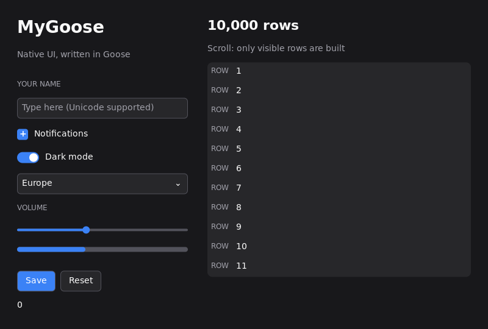

# Platform boundaries and validation

The Goose core owns state, controls, UTF-8 editing, focus, layout, virtual
lists, dropdowns, scene hashes and damage. It contains no OS selection code.
Each native backend implements [backend.h](../native/backend.h), a small C ABI.
No platform loads or links the other platforms' implementations.

| Layer | Location | Responsibility |
| --- | --- | --- |
| Portable UI | `src/` | Controls, layout, interaction, damage, painting and frame runners |
| Native contract | `native/backend.h` | UTF-8 slices, logical pixels, normalized events, drawing, clipboard and IME |
| Optional vector target | `native/vector_target.h`, `extras/graphics/native/` | Opaque target access and separately linked vector drawing |
| Windows | `native/windows/` | Win32, Direct2D/DirectWrite, IMM/candidate caret |
| Linux | `native/linux/` | X11, Cairo/Pango, XIM, selection clipboard |
| macOS | `native/macos/` | AppKit, CoreGraphics/CoreText, NSTextInputClient, NSPasteboard |
| Package integration | `src/mygoose.build`, `src/CMakeLists.txt`, `CMakeLists.txt` | Native dependencies selected for the build host |
| Local builds | `tools/build.py` | Native compiler, OS-specific flags and test selection |

Windows debug/release tests and Linux tests on Ubuntu 22.04 under WSL2 pass
(2026-10-20). Linux window tests pass both on a private Xvfb display and on WSLg.
On 2026-10-21, Apple Silicon macOS 26.6.2 passes all debug and optimized targets,
including AppKit window tests and the activity monitor. The optional manual CI
template remains inactive; these are local validation results.

## Backend rules

- All exposed text is UTF-8 and offsets are byte offsets. Convert UTF-16,
  wchar or NSString indexes inside the native adapter.
- The core's existing key codes are normalized virtual keys, not native key
  codes. Modifier bit 1 is Shift; bit 2 is the editing shortcut modifier.
  macOS maps Command/Control to bit 2 and Option with word-navigation keys
  to the same word-edit operations.
- Coordinates are logical pixels. Drawing, measuring, pointer input and IME
  candidate rectangles must use the same scale.
- Wheel input distinguishes detents from precise logical-pixel distances:
  `mg_event_scroll_pixels` is forwarded as `Event.scroll_pixels`. macOS
  trackpad/Magic Mouse deltas, including momentum, scroll by their supplied
  point distance without a row-height or Retina multiplier. Coarse wheel
  events keep the existing three-row steps. Dropdowns accumulate fractional
  input until it reaches one 30-point row.
- Pointer capture belongs to the shared interaction lifecycle. `mg_capture`
  captures/releases only the calling window; event 13 reports native capture
  loss separately from event 7 (blur), preserving logical keyboard focus.
- Retain the framebuffer, bound text-layout caches, and block while idle.
  Headless drawing must work without an OS display connection.
- Clipboard writes report success so failed Cut never deletes text. Headless
  contexts use private clipboard storage. External paste that exceeds capacity
  fails without removing the selection.
- `mg_paint_regions` begins one frame with 1–16 damage rectangles. A true return
  preserves the union clip, so portable painting can skip controls in its gaps.
  A false return clears and clips the bounding rectangle; portable painting must
  include those gaps. macOS implements the union. Windows uses a pixel-aligned
  union for sparse transfers from Direct2D into the retained bitmap, allowing
  the shared painter to skip unchanged nodes between regions. Direct2D still
  rasterizes submitted primitives inside their bounding/node clips. Dense
  updates and allocation failures use the bounding fallback; Linux currently
  always uses it. Windows keeps two reusable region handles, with no additional
  frame-sized bitmap, layer or Goose core storage.
  `mg_paint_begin` continues to support a single rectangle directly.
- A partial repaint must match a full repaint in the same backend. Pixel
  identity across different font/rendering systems is not a requirement.
- Renderer IDs are stable: 1=Direct2D, 2=Cairo/Pango, 3=CoreGraphics/CoreText.
- Keep the ABI main-thread-only; no runtime callback objects cross into Goose.

## Windows live resize

User32 runs its own [modal move/resize loop](https://learn.microsoft.com/en-us/windows/win32/winmsg/wm-entersizemove),
which can hold an ordinary outer event loop inside `DispatchMessage` until the
drag ends. The Windows backend runs native dispatch on one private fiber and
yields `WM_SIZE` events back through the existing `mg_wait` API during that loop.
A 16 ms timer exists only during moving/sizing, keeping animated views and live
data responsive even when the pointer stops. Exiting the drag removes the timer
and delivers a final resize event. Normal idle windows still block.

Client pointer capture is tracked separately from native move/resize capture,
even though both use the same HWND. Entering the native loop transfers ownership
to User32, so UI cancellation during resize cannot release the window edge drag
or replace its cursor.

Goose view/layout/paint executes on the original caller fiber of the same UI
thread. No runtime Goose function pointer or additional OS thread is needed.
The native fiber is created lazily on the first non-headless wait; it reserves
1 MiB of address space with 16 KiB initially committed. Headless tests allocate
no fiber. Shutdown first unwinds any suspended native callback, deletes the
dispatch fiber and restores thread/fiber ownership. Existing fiber hosts retain
their caller fiber.

Resize buffers retain overlapping pixels and initialize new areas with opaque
background pixels. Native paint/erase covers exposed areas beyond a pending
bitmap, and Direct2D rebinds every replacement DIB, including shrink/grow cycles
that return to the previous dimensions. Resizes disable User32's saved client
copy with [`SWP_NOCOPYBITS`](https://learn.microsoft.com/en-us/windows/win32/api/winuser/nf-winuser-setwindowpos)
and flush retained-frame presentation before layout and after native geometry
processing, so an old copy cannot overwrite a newly rendered frame. This avoids
presenting zero/transparent storage while a new scene is pending. Native caption styles, paint suppression
and system animation commands remain in the optional frame adapter.

Windows native tests exercise nested resize dispatch with real hidden HWNDs,
real timer messages, redraws and UI cancellation without losing native capture
before the modal loop exits, opaque erase/pixel capture, top/left geometry changes,
close during a sent callback, standard/custom frames and fiber lifecycle. The
fixture does not move the desktop pointer or change system animation settings.

## Linux and WSL2

The initial Linux window backend targets X11, including XWayland on a Wayland
desktop. WSLg supports X11 and Wayland GUI applications; this backend uses
its X11 server. See [Microsoft's WSL GUI documentation](https://learn.microsoft.com/en-us/windows/wsl/tutorials/gui-apps).
Native Wayland protocol support is a separate future adapter.



Install the build/test dependencies inside the chosen distribution:

```sh
sudo apt-get update
sudo apt-get install build-essential python3 pkg-config libx11-dev libcairo2-dev libpango1.0-dev xvfb
```

From Windows, using the existing Windows Goose compiler:

```powershell
python tools/wsl.py test --mode debug
python tools/wsl.py all --mode small
python tools/wsl.py gallery --mode small --run
python tools/wsl.py test --distro Ubuntu-22.04
```

The helper emits standalone portable C on Windows and invokes **Linux GCC**
inside WSL. The results are Linux ELF executables, not Windows executables
run through Wine. Tests use a private Xvfb server, so native clipboard tests
cannot replace the Windows/WSLg clipboard. `--run` on an example uses WSLg.
No Linux Goose compiler is needed for this route.

On a native Linux machine with Goose installed:

```sh
python3 tools/build.py all --mode small
MYGOOSE_TEST_CLIPBOARD=1 xvfb-run -a python3 tools/build.py test --mode debug
./build/linux-small/gallery
```

Alternatively, transport `build/portable-small` emitted by
`python tools/build.py all --mode small --emit-only`, then compile it with
`python3 tools/build.py all --mode small --from-c build/portable-small`.
Re-emit after Goose source changes; `--from-c` deliberately consumes the supplied C.

Linux selects the `cairo` renderer. `MYGOOSE_SCALE=1.5` overrides the initial
window scale (0.5–4); automatic per-monitor scaling is pending. Fonts and
shaping are supplied by Pango/fontconfig; install a CJK font for Japanese.
No font files are bundled into MyGoose executables.

The Linux native test exercises actual X11 mouse/key delivery, UTF-8 commit,
XIM preedit callbacks, clipboard ownership/UTF8_STRING transfer, resize and
close/reopen. A real Japanese input-method server and candidate popup have
not been tested. Callback-style XIMs control candidate placement; matching
Windows' candidate anchoring remains a Linux follow-up. Clipboard reads reject
oversized/INCR transfers, with a bounded 500 ms wait. Selection data persists
while the app owns the clipboard; persistence after exit requires a desktop
clipboard manager.

## macOS validation

Install the Xcode Command Line Tools (`xcode-select --install`), Python 3.10+
and CMake 3.27+ on the Mac. The adapter uses only Apple system frameworks.
The compiler bootstrap also needs Git and a C++20 compiler; Apple Clang supplies
both the C and C++ compilers. No Windows files or separate dependency checkout
are needed. From a fresh clone:

```sh
python3 tools/bootstrap.py
python3 tools/build.py gallery --run
python3 tools/build.py test --mode debug
python3 tools/build.py all --mode debug
python3 tools/macos.py --all --install
```

`tools/bootstrap.py` builds the pinned upstream Goose source inside
`.toolchain/goose`, which `tools/build.py` discovers automatically. Rerunning
bootstrap reuses that checkout and CMake build. `GOOSE`/`--goose` and
`MYGOOSE_CC`/`--cc` override compiler selection; compilers on PATH also work.

Alternatively, transport portable C emitted on another host:

```sh
python3 tools/build.py all --mode small --from-c build/portable-small
./build/macos-small/gallery
```

`all` on macOS includes every library example, the monitor and all tests.
`tools/macos.py` builds and signs local `.app` bundles, then optionally installs
them into `~/Applications/MyGoose`. `--skip-build` packages existing binaries;
without `--all` the defaults are Gallery and Activity Monitor. Bundles include
Finder/Dock icons drawn from local SF Symbols.
Icon gradients use constant-color scanlines to keep PNGs compact without
dropping any resolutions (16px through 1024px); packaging also applies lossless
PNG compression when Xcode's `pngcrush` is available. Basic examples use a standard
native title bar; the monitor extends content into the title bar and retains
real AppKit traffic lights. `--window-style standard` keeps the standard title
bar in a bundled monitor. Both styles use Retina rendering, the macOS system
font and an application menu with Command+Q.
The installed bundles contain their executables and do not need the source
checkout or Python to run. They are locally signed, not notarized for distribution.

`tests/macos.m` covers AppKit lifecycle, marked/committed UTF-8 text, candidate
coordinates and bitmap painting. It requires WindowServer. The portable UI
suite and `tests/native.c` use headless rendering without creating NSApplication.
Both paths pass locally. The live Retina gallery was checked for typing,
Command+A, Japanese UTF-8 paste and virtual-list scrolling. Automated tests
exercise marked/committed Japanese text and candidate coordinates. Display
changes, Option navigation and live Japanese IME conversion still need manual
verification. The text-input bridge exposes marked text, not a full
surrounding-document text store.

CoreText baselines center the system font's cap/descender band in the shared
`size * 1.4` line box. Base-font metrics keep mixed Latin/CJK labels on a stable
baseline. Pixel tests check vertical alignment at 1x/2x, regular/bold and
multiple font sizes.

The text cache holds 512 shaped lines so a process table does not evict its own
visible labels on every scroll frame. Presentation draws the CoreGraphics
bitmap directly and releases snapshots within the frame's autorelease pool.
During AppKit's nested live-resize loop, the last frame stays at its original
logical size and exposed regions use the UI background until the next paint.
Native dispatch runs on a private stack and yields each resize through
`mg_wait`, so Goose lays out and paints every intermediate size on its original
stack, on the same AppKit thread. A 16 ms tracking-mode timer keeps animations
and sampling active while the pointer rests; it is removed when resizing ends.
Ordinary idle waits still block. The stack is allocated lazily on the first
window wait, reserves 2 MiB with guard pages and commits memory on demand;
headless windows allocate no dispatch stack. Shutdown unwinds suspended native
callbacks before releasing that storage. The small context switch supports
arm64 and x86_64 and preserves callee-saved registers and floating-point modes.
Resize tests cover continuous nested dispatch/painting, timer wakeups, close
during resize, retained content, exposed regions, shrink/grow and backing-scale
changes at 1x/2x. A separate native test exercises 10,000 context round trips.

The macOS monitor samples CPU/per-core counters through Mach, process CPU,
resident/virtual memory and I/O through libproc, memory/swap through Mach and
sysctl, whole-device disk I/O through IOKit and 64-bit interface traffic through
the routing API. Disk space refers to the writable Data volume. Swap allocation
appears in place of Windows/Linux commit utilization, with explicit swap labels.
Process CPU time uses the machine's Mach timebase, verified against `getrusage`.
Visible process icons come from NSWorkspace and the outer app bundle, so helpers
share their application's icon. A 64-image LRU and 512-entry PID/creation-time
cache bound storage; inaccessible paths keep the generic Goose icon. GPU
counters are unavailable. Process termination returns
unsupported because this implementation cannot atomically signal a process
with a verified creation time; Finder reveal uses `/usr/bin/open -R`.

## CI and measurements

There are no active workflows in `.github/workflows`. The optional template
[`docs/ci/native.yml`](ci/native.yml) has only a `workflow_dispatch` trigger:
no push or PR runs. To enable it later, copy it to `.github/workflows/native.yml`
and push with GitHub credentials allowed to modify workflows (classic OAuth/PAT
credentials need the `workflow` scope). Then choose **Native backends → Run
workflow** in GitHub Actions and select macOS (the default), Linux, Windows or
all. It uses the same pinned compiler bootstrap as local development, emits
debug/small C artifacts, then compiles and tests on the chosen native runners.
Unix jobs also compile the CMake package target. The Mac job uploads a headless
gallery image for inspection. No Git hooks or required branch checks are installed.

See the [benchmark guide](../bench/README.md) for the shared headless benchmark,
Monitor scrolling and steady-window workloads, and Performance frame pacing.
`tools/measure.py` collects hidden-window memory on Windows; the macOS Monitor
probe records RSS and physical footprint. Generated output stays in `build/`.
