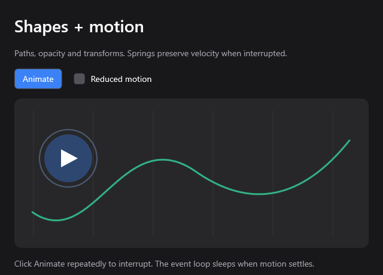

# Rich UI with an optional cost

MyGoose's basic layer stays responsible for controls, layout, text editing and
damage tracking. Richness belongs in separate packages with their own state and
native objects. Importing/calling a feature must not add buffers or registries
to every `Context` or `Node`.

MyGo's [paths](https://github.com/egoist/mygo/blob/5fb60098a44a4c629cbdeac5f0ff80ce2f843c2f/ui/path.go),
[motion](https://github.com/egoist/mygo/blob/5fb60098a44a4c629cbdeac5f0ff80ce2f843c2f/ui/motion.go),
and [canvas](https://github.com/egoist/mygo/blob/5fb60098a44a4c629cbdeac5f0ff80ce2f843c2f/ui/canvas.go)
APIs informed the separation. This is a small foundation, not MyGo feature parity.
MyGo's cached bitmap canvas is a later layer; today's MyGoose canvas is a
clipped vector drawing region in the existing window framebuffer.

| Package | Available now | Cost when unused |
| --- | --- | --- |
| `mygoose` | Existing controls, flex layout, text, dropdowns and shadows | Baseline |
| `extras/graphics` | Paths, solid fill/stroke, rounded rectangles, ellipses/circles, lines, quadratic/cubic curves, opacity, translation, rotation, uniform scale | Native vector object omitted; no core storage added |
| `extras/motion` | Retargetable tweens, compile-time easing, analytic springs, reduced-motion override and settling | No tracks, clock updates or timers added to basic run |
| `extras/motion/app` | Event loop for animated standard controls, independently of vector drawing | No vector object or canvas storage |
| `extras/images` | Immutable RGBA bitmaps, scaling, clipping, opacity; used for Windows/macOS process icons | Native image object omitted; storage allocated only for uploaded images |
| `extras/window` | Windows custom caption and controls; macOS integrated caption with native traffic lights | Native frame object and DWM dependency omitted; no core node/context storage |
| [`extras/charts`](../extras/charts/README.md) | Dot/bar histories, hover hit testing, percentage rings and configurable palettes | Chart object omitted; no sampler, vector dependency or core storage |



```powershell
python tools/build.py rich --run
python tools/build.py motion --run
python tools/build.py rich-test --mode debug
python tools/wsl.py rich --mode small --run
```

The demo's Animate button moves/fades a circle and rotates an arrow. Press it
again during motion to change targets. The spring preserves velocity; tweens
preserve position. Reduced motion snaps to targets. Initial values snap on
first use, so entering a view does not animate from an arbitrary zero.

## Using a drawing region

```goose
import mygoose from "path/to/mygoose";
import mygoose_graphics from "path/to/mygoose/extras/graphics";
import mygoose_motion from "path/to/mygoose/extras/motion";
import mygoose_motion_app from "path/to/mygoose/extras/motion/app";

struct State {
    expanded: bool = false,
    x: mygoose_motion::Spring = mygoose_motion::Spring {}
}
fn view(s: State&, c: mygoose::Context&, f: mygoose_motion::Frame&) {
    mygoose::column(c, mygoose::Box { gap: 12.0 }) {
        if mygoose::button(c, "Move") { s.expanded = !s.expanded; }
        let x = mygoose_motion::spring(s.x, f, if s.expanded { 200.0 } else { 40.0 });
        mygoose_graphics::canvas(c, 280.0, 120.0, "scene") { p =>
            mygoose_graphics::circle(p, x, 60.0, 24.0,
                mygoose_graphics::Brush { color: 0x3b82f6 });
        };
    };
}
fn main() {
    var s = State {};
    mygoose_motion_app::run(s, mygoose::WindowOptions {}, view, mygoose_graphics::paint);
}
```

Use `mygoose_graphics::run` for a static two-argument view, or pass
`mygoose_graphics::paint` to the motion runner for the animated view above.
The basic `mygoose::paint` handles only basic controls.
Give every canvas a stable, explicit key. Coordinates inside it are local
logical pixels; its rectangle clips fills and strokes, including transformed
geometry. It occupies layout space like a fixed-size leaf.

For animated standard controls without custom drawing, use
`mygoose_motion_app::run` instead. The `motion` example demonstrates this and
has no reachable vector binding. Static drawing needs only the core and graphics
imports; animated drawing also declares the motion packages at the application
root. See [API and examples](api.md) for runner selection and painter composition.

`Path` supplies `move_to`, `line_to`, `quad_to`, `cubic_to`, `close` and `reset`.
`draw_path` fills when `Brush.width` is zero and strokes when it is positive;
fill and stroke can be separate calls with separate brushes. Fills use the
even-odd rule, so multiple subpaths can make holes. Strokes use round caps and
joins. Opacity is 0–1. Scoped `translate`, `rotate` (radians), `scale` (positive,
uniform) and `opacity` compose and restore their prior values after the block.
As with layout blocks, lexical returns bypass scope-restoring code; use
conditionals or a named child function for early exits.

Paths hold at most 128 segments and a painter holds at most 8 KiB of encoded
commands. The command stream is copied into the existing 64 KiB frame arena;
there is no second scene buffer or bitmap allocated for each canvas. Bounds
checks fail rather than overwriting storage. Coordinates are bounded to
±1,000,000 logical pixels and strokes to 4,096 pixels. Capacity choices are
local to this optional layer and can be changed independently of core storage.

This first canvas API does not add shape hit-testing, automatic sizing, image
decoders, gradients, arbitrary affine matrices, masks, cached layers or filters.

## Motion and scheduling

`Tween` and `Spring` live in application state. They have no global track map,
IDs, heap objects or closures. One monotonic timestamp is shared across both
builds of a logical frame, so event-driven rebuilding never advances a track
twice. Durations use milliseconds and spring frequency uses Hz. Spring damping
below 1 bounces, 1 is critical damping, and above 1 is overdamped.

Tweens default to smoothstep easing. Pass `linear`, `ease_out`, or a compile-time
function block as the last argument:

```goose
let opacity = mygoose_motion::tween(s.fade, f, target, 250.0,
    mygoose_motion::ease_out);
let scale = mygoose_motion::tween(s.scale, f, target_scale, 180.0) { t => t * t };
```

Keep easing functions pure and use one consistently for each track. Springs solve the damped
oscillator analytically rather than accumulating numerical integration error.
They maintain value and velocity on retargeting and request no more frames once
within precision. A rich runner wakes at roughly 16 ms only while a track is
active; otherwise it uses the existing blocking event loop. An explicit
`WindowOptions.animate_ms` still requests continuous timers. `Frame.reduced`
or the runner's `reduced_motion` argument overrides animation; reading OS
reduced-motion preferences automatically remains future work.

## Why basic apps stay small

The packages have their own sidecars and are not imported by `mygoose.goose`.
The renderer's extra painter is a compile-time parameter, with an empty basic
specialization. `Context` and `Node` are unchanged. The motion clock exists only
in the rich runner; ordinary windows block while idle.

Native vectors are a separate C object for each OS. They query an opaque drawing
target only when called. Windows reuses Direct2D; Linux reuses Cairo;
macOS reuses CoreGraphics. No new renderer DLL or framework is introduced.
The custom build script detects the reachable `mg_vector` binding in generated
C and compiles/links that object only for clients that need it. Goose's native
package build uses the graphics package's sidecar.

Separating native objects matters on MinGW: its DLL import table can retain
imports from unused functions even if their code was discarded. Putting vector
functions into the base object's source added 512 bytes to the basic counter;
moving them out restored the baseline. Source separation plus link elimination
is verified by executable size, rather than assumed from unused code.

The native vector, motion and repaint tests run through `rich-test` on each
supported backend. They cover retargeting, reduced motion, malformed streams,
alpha, clipping, popup layering and partial/full repaint equality. Native
window behavior is covered by the platform tests. Use the
[benchmark guide](../bench/README.md) for reproducible size and rendering
measurements; system libraries and fonts are outside the executable size.

Additional assets, effects or widgets should own their model and bounded caches
inside an optional package. Basic controls should not acquire global timers,
codecs, textures or feature registries when that package is unused.
